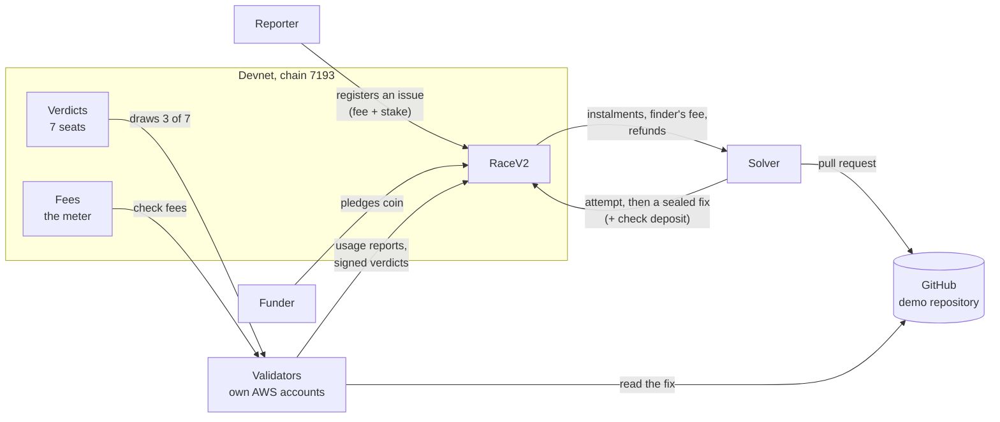
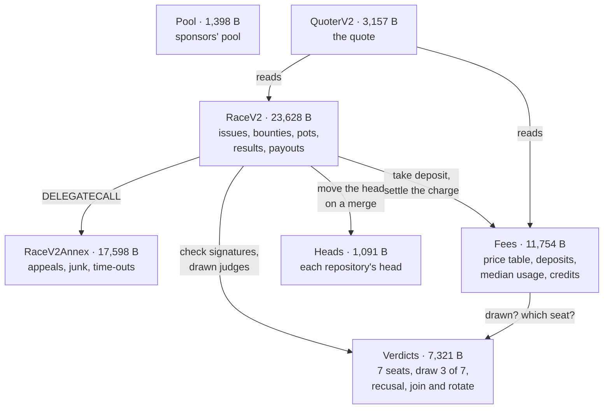
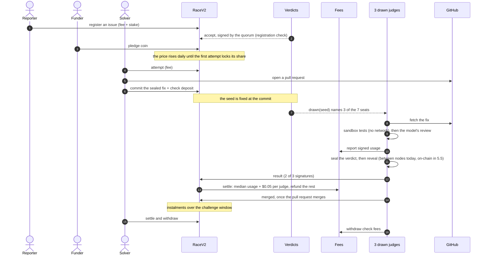
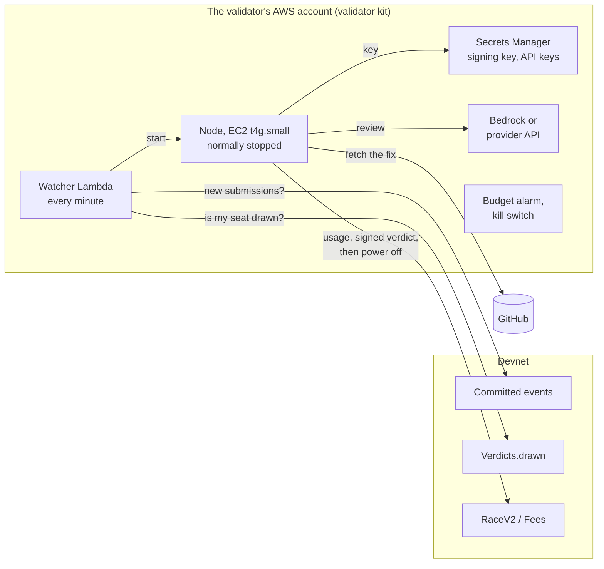
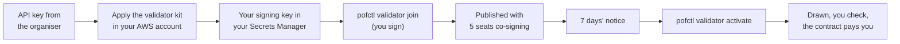
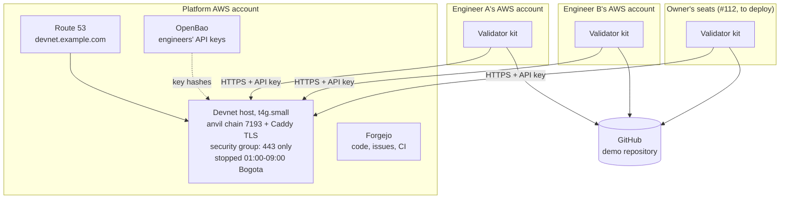

# proof-of-fix

> Private snapshot for sharing. Development happens on a private Forgejo, which keeps the full history; issue numbers (`#123`) refer to its tracker, and example.com and example-org stand in for internal addresses.

**Bounties for open-source fixes, judged by independent AI validators, paid by keyless smart contracts** (it-ops#14).

Anyone funds a bounty on an issue. The first fix that passes wins its price. Each fix is checked by **3 validators drawn at random from 7 seats**, each running its own AI model on its own infrastructure, and **the contract pays every validator for the checks it counts.** Nobody, the owner included, can change the rules except by a new version.

**Status: a private devnet, no real money.** The contracts run on a private Ethereum devnet with a test coin (`https://devnet.example.com`, invited engineers only). There's no public chain, no token (it's parked) and no real funds until the owner decides to go public (rule 1 in `openspec/config.yaml`). The architecture is recorded in [ADR 0002](docs/adr/0002-architecture-v2.md).

## Architecture

### Who does what


### The contracts (v2, keyless, coin only)

Sizes are runtime bytes; the limit is 24,576 (EIP-170). No contract has an owner, an admin, an upgrade or a pause. v1 (`Race`, `Token`, `Quoter`) stays deployed and untouched; the token is parked. Details: [`reports/contract-v2.md`](reports/contract-v2.md).

### The life of a bounty


### A validator's infrastructure, in its own AWS account

Idle it costs about $2–3 a month; a run costs about $0.005 plus the model calls. See [`validator-kit/`](validator-kit/README.md).

### Joining as an engineer

The guide: [`docs/participate.md`](docs/participate.md).

### Where it runs

The devnet is about $15 a month (platform#199, #200).

## What's built and what's left
The devnet runs the money and the draw end to end. These parts of a real network are still to come:

| Gap | What it means | Why it matters | Issue |
|---|---|---|---|
| **The node fetches the fix itself** | Today the end-to-end test hands each node the fix's code. A live node must fetch the pull request's commit from GitHub. | Without it, a validator on its own AWS account has nothing to test. | #115 |
| **The sandbox inside the node's container** | The fix's tests run in a locked-down container started by the node, which needs Docker access inside its own image. | Without it the node can't run tests on AWS, only in the local test. | #116 |
| **Judges on separate machines** (the aggregator) | Drawn judges exchange sealed verdicts and signatures. Today they share a folder on one machine. | Validators in different AWS accounts can't coordinate, so a live check can't reach 2 of 3. | #117 |
| **Direct model calls** | A counted judge calls the model provider straight from its node, not through a proxy. | Otherwise a middleman could alter the answer it relays. | #118 (after #115–#117) |
| **Attestation** (secure hardware) | The node runs in a TEE (AWS Nitro or Phala dstack) that proves which checker ran and what the model answered. | Until then, a verdict is trusted on its seat's key alone, which is enough for the devnet but not beyond. | #94 |
| **Bonds, slashing, challenges** (5.8) | Seats post a bond, lost for provable cheating, and anyone can challenge a verdict or a price change. | Without them cheating costs nothing but reputation, and the price challenge isn't enforced. | #85 |
| **Seals on-chain** (5.5) | Judges commit a hash of their verdict before revealing it, enforced by the contract. | Today the nodes enforce it among themselves; on-chain, a lazy judge can't copy another's verdict. | #85 |
| **Receipts on-chain** (5.6) | Each verdict carries its attested receipt's hash, and receipts can be challenged. | It ties every payment to evidence of the check that earned it. | #85 |
| **Data availability** (5.9) | A new head counts only once 5 of 7 seats confirm they hold the code, plus a permanent copy. | Without it, a merged fix could be lost if every host dropped it. | #85, #92 |
| **Constitution and ADR challenges** (5.10) | The constitution's hash on-chain, ADRs passed by 5 of 7 with 14 days of challenges. | It's how the rules change without anyone holding a key. | #85 |
| **Migration from v1** (5.13) | v1's bounties finish in v1, and new ones open in v2. | Needed before v2 replaces v1 anywhere it's live. | #85 |
| **Pipeline status for agents** | A Forgejo MCP tool to read Actions runs and logs. | So failures can be diagnosed without screenshots. | agentcore#97 |
| **The live demo** | v2 deployed on the devnet with vacant seats, the owner's seats deployed, engineers invited, the private GitHub repositories created. | It's the step from "works in tests" to "engineers earn from their own AWS". | #104, #112 |

## Take part
Invited engineers: read [`docs/participate.md`](docs/participate.md). You need an API key from the organiser and an AWS account of your own.

## The research and the simulation
proof-of-fix began as a simulation of incentive mechanisms. The original design (the legacy pool):
People who contribute stake on their pull requests. A pull request ships in a beta build with its payment held in escrow. During a challenge window, staked validators can prove a regression with objective evidence: a test that passes before the change, fails after it and bisects to it. If nobody does, the contributor is paid and the stake returned. Every release pays contributors, validators, the upstream author's escrowed share, infrastructure and the owner.

### Upstream

The PoC target is [storytold/gridcraft](https://github.com/storytold/gridcraft), an open-source spreadsheet in Rust (MIT OR Apache-2.0), starting with its formula core. This project is independent and not endorsed by its authors. Anything taken from upstream keeps its license, `NOTICE` and attribution. Fixes go back upstream. The author's share is held until a maintainer claims it themselves.

### Running the simulation

Python 3.9 or later, standard library only. From the repository root.

**The bounty market is the default** (owner's decision, 2026-10-24); see "The bounty market" below. The commands in this section run the **legacy pool** (`LEGACY` in `pof/params.py`): a fund per release split by lines changed. It was the placeholder of runs v1–v5, and it's kept to compare with and to reproduce them.

```sh
python3 -m pof.sim run --scenario spam --seed 1                 # one run's report (JSON)
python3 -m pof.sim run --scenario collusion --seed 1 --share 0.4
python3 -m pof.sim run --scenario owner --seed 1 --self-interested
python3 -m pof.sim run --scenario replay --seed 1 --mechanism-off # GridCraft's contribution stream only
python3 -m pof.sim run --scenario sponsorship --seed 1          # sponsored newcomers and a sponsorship abuser
python3 -m pof.sim accept --seeds 20 --summary                   # the acceptance check: passed + failures
python3 -m pof.sim summary --seeds 100 --sweep-seeds 20 > reports/acceptance-v5.json
bash scripts/check.sh                                            # OpenSpec validation + all tests
```

Scenarios: `honest`, `spam` (spammers, a splitter, a padder, a pledge stacker, an index gamer), `griefing`, `collusion` (`--share`), `owner` (`--self-interested`), `replay` (`--mechanism-off`), `risk` (`--multiplier`), `sponsorship`.

**Reading a report.** Amounts are credits.
- `returns`: each actor type's mean net gain, also per action and per unit staked.
- `group_returns`: a cohort's total (a collusion ring; an abuser and its sponsored fake accounts).
- `contributions` and `challenges`: outcome counts.
- `escaped_regressions`: defective contributions accepted and never clawed back.
- `releases`: each release's split.
- `author_escrow`: the upstream author's unclaimed share.
- `owner_payout`: everything the owner earned.
- `pr_returns`: what each kind of author earns per contribution, defective or sound.
- `pledges`: stakes partly backed by unpaid rewards (proof-of-fix#19), with the amounts pledged and lost.
- `turning_actors`, `contributors_pool_end`, `stake_index_end`: the stacker's and the index gamer's stakes before and after they turn; capped rewards left in the pool; the stake index (proof-of-fix#23).
- `panels`: approvals, decline limits, appeals and refused split changes.
- `conserved`: the ledger check.

`accept` lists every failed criterion with its scenario and seed. Defective work is judged with standard errors (attackers must lose money significantly; groups under 50 defective contributions are inconclusive), and splitting per accepted line. The latest run and what it means are in [`reports/acceptance-v5.md`](reports/acceptance-v5.md) (robust verdicts on 100 seeds, funding that follows use, #27). It also corrects the earlier reports' splitting verdicts. The earlier runs are [`reports/acceptance-v4.md`](reports/acceptance-v4.md) (the indexed stake and the reward cap, #23), [`reports/acceptance-v3.md`](reports/acceptance-v3.md) (pledged stakes, #19), [`reports/acceptance-v2.md`](reports/acceptance-v2.md) (the #10 rules) and [`reports/acceptance-defaults.md`](reports/acceptance-defaults.md) (the first defaults).

### The bounty market (proof-of-fix#15)

`reward_source = "market"` (the default in `pof/params.py`) pays by bounty instead of the legacy pool:
- pledges, or a small treasury budget, fund bounties;
- **the race** (`award_mode = "race"`, the default since #60; the owner: "the first valid PR wins"):
  - anyone opens a bounty by paying an AI registration check (worthiness, acceptance criteria, an effort estimate), refunded when it's solved; the check refuses an issue similar to one whose bounty is open (#56);
  - a bounty has no target: it opens at once and anyone funds it while it's open, so the market sets its value (#56);
  - small issues are bundled;
  - the price is a share of the funds, opening at half and rising daily until the first attempt locks the share; later pledges still raise it (#56);
  - starting an attempt costs a small fee, and arriving after the bounty is won costs the evaluation fee (#64);
  - anyone submits, paying its own checks, and the first submission through the project's constitution (quality gates) and the AI juries wins;
  - a failed fix can't be resubmitted, but its author may appeal once to the second jury; a fix wrongly flagged as someone else's can be appealed to a jury of 3 providers (#64);
- payment comes on release through the same enforcement layer.

The sealed second-price auction (bid first, build after, #30–#55) stays as `award_mode = "auction"` (`--award-mode auction`), to compare with and to reproduce the runs before #60.

```sh
python3 -m pof.sim market run --scenario market_spam --seed 1    # one market run's report
python3 -m pof.sim market modes --seeds 100 --sweep-seeds 20 > reports/acceptance-modes-v5.json   # the award modes compared
python3 -m pof.sim market split --seeds 40 > reports/split-v2.json   # the reporter's and the solver's split
python3 -m pof.sim market tokens --seeds 40 > reports/tokens-v4.json   # the token emission at each token price (#58)
python3 -m pof.costs   # running costs per check, paid fix and ADR: the tables of reports/costs-v1.md (#82 B2)
python3 -m pof.sim.oraclenet fees --seeds 100    # #85 check gas against flat fees, the table raised, the operator's break-even (reports/self-healing-v1.md)
python3 -m pof.sim.oraclenet bonds --seeds 100   # #85 seat bonds: every slashable fault against its honest twin
python3 -m pof.sim market summary --seeds 100 --sweep-seeds 20 --award-mode auction > reports/acceptance-checking-v6.json
```

**Discoverers and funders** (proof-of-fix#34):
- whoever reports an issue stakes on it, and earns 15 % of what the bounty pays out when its fix is paid; the solver gets 85 % (#56, [`reports/split-v1.md`](reports/split-v1.md));
- half the treasury budget matches pledges quadratically;
- a bounty nobody can solve closes after 4 empty rounds and refunds by input.

**Reputation** (proof-of-fix#37): every account earns a non-transferable score per role from outcomes on the ledger. Trust from it does three things:
- weights matching;
- ranks treasury proposals;
- lowers a proven solver's bond.

Scores can be recomputed from the `reputation` events (`pof/reputation.py`).

**Against collusion and mispriced risk** (proof-of-fix#40):
- no price is above a reserve, 75 % of the bounty's price cap, so a lone bidder or a ring can't take the whole cap;
- an account earns at most 1 reputation point per role per release;
- in the simulation, solvers price risk from their own record.

**Checking by AI oracles** (proof-of-fix#43):
- **CI:** attested runners (MCP test runners in TEEs, two per delivery, from different operators and hardware vendors) run the public and hidden tests.
- **Judging:** AI consensus. Three evaluators must all accept; a split goes to a second AI jury of seven, which accepts with five. No person decides a delivery.
- **Scoring:** evaluators are scored on the truth (Brier), on planted cases and revealed fates.
- **Oracle fees, paid by the contributor** (proof-of-fix#49): every bid posts a check deposit worth one attempt's checks; the assigned solver's checks are paid from it, and the bounty pays none.
- **After a failure:** the attempt is published and a fresh round opens, capped at the failed price. A "not solved" challenge catches incomplete fixes.
- **Reputable models only** (proof-of-fix#47): each provider's top generally available model, from at least three providers, above an accuracy bar. Every verdict carries a proof of its model (TEE attestation or zkTLS). Juries are seated from the leaderboard, top to bottom, and verdict fees follow each evaluator's accuracy tier.

Scenarios: `market`, `market_bluff`, `market_noshow`, `market_spam`, `market_ring`, `market_flood`, `market_grief`, `market_owner`, `market_farm`, `market_self`, `market_rep`, and the checking attacks `check_lazy`, `check_herd`, `check_copy`, `check_craft`, `check_plant`, `check_sock`, `check_half`, `check_split` and `check_cheat`, and the award-mode attacks `mode_pad`, `mode_variant`, `mode_inflate` and `mode_fake` (#60, #64). Returns are net of each actor's effort.

The token emission (#58, simulated tokens only) is in [`reports/tokens-v4.md`](reports/tokens-v4.md): 0-coin bounties now close after their clawback period, as on-chain, and a ring fails only when it gains at others' cost; **every criterion passes at token prices 0.01 and 0.05**. Before it, [`reports/tokens-v3.md`](reports/tokens-v3.md): with a 1 % founder's share, a reporter's share forfeited above 3x the merge estimate, and rings judged by what they cost others, **every criterion passes at token prices 0.01 and 0.05**. Before it, [`reports/tokens-v2.md`](reports/tokens-v2.md) (rings measured: they cost no one), and [`reports/tokens-v1.md`](reports/tokens-v1.md): tokens are worth having from a token price of about 0.05 coin, where the market fixes 48 % more bounties at 10 % less per fix; at each swept price one earlier criterion fails, each named and explained there. Without tokens, the market is unchanged.

The latest run is [`reports/acceptance-modes-v5.md`](reports/acceptance-modes-v5.md) (#56, the contract review: the price's share is locked, not its amount; locking on the first submission was measured and dropped). Before it, [`reports/acceptance-modes-v4.md`](reports/acceptance-modes-v4.md) (#56: the market funds bounties with no target, and reporters get 15 %): **the race passes every criterion**, fixes 11 % more bounties, and reporters earn +27 a run instead of +1.5. Before that, [`reports/acceptance-modes-v3.md`](reports/acceptance-modes-v3.md) (#64: nothing is free; fake attempts don't pay, and falsely flagged fixes win on appeal), and before that, [`reports/acceptance-modes-v2.md`](reports/acceptance-modes-v2.md): **the race passes every criterion**, and compared with the auction it fixes 26 % more bounties, in 13 days instead of 21, at 97 % quality. Funders pay about twice as much per fix (116 against 60), and about half of solvers' effort is spent on attempts that weren't first. Before it, [`reports/acceptance-checking-v6.md`](reports/acceptance-checking-v6.md) (the auction): **every criterion passes at every hunting elasticity**. With top models from the leaderboard, AI consensus wrongly rejects 11 % of good fixes (25 % in v5), and honest solvers earn +20. Results still rest on the assumed model accuracy until the real-data measurement. The earlier runs:
- [`checking v5`](reports/acceptance-checking-v5.md) (the contributor pays its checks) and [`v4`](reports/acceptance-checking-v4.md) (the bounty paid them);
- the market runs before it: [`market v4`](reports/acceptance-market-v4.md) (passes at every hunting elasticity), [`v3`](reports/acceptance-market-v3.md), [`v2`](reports/acceptance-market-v2.md) and [`v1`](reports/acceptance-market-v1.md).

## Layout

- `openspec/`: specs and changes (spec-driven; rules in `openspec/config.yaml`).
- `pof/`: the mechanism (ledger, params, lifecycle, challenges, payouts, market, reputation, checking) and `pof/sim/` (actors, world, scenarios, the market and checking simulations, report).
- `data/gridcraft_baseline.json`: aggregated GridCraft PR history (`scripts/fetch_baseline.py`).
- `reports/`: acceptance runs.
- `data/judges/manifest.json` and `pof/judges/`: B1's labelled set of real fixes and the judges' harness (#85): `scripts/judge-set.sh build` rebuilds the set in a container, `scripts/judge_run.py plan` prices the run, and the paid run, through the owner's model gateway under hard token and dollar limits, waits for the owner's approval ([`reports/judges-v1.md`](reports/judges-v1.md)).
- `docs/adr/`: architecture decision records; [ADR 0002](docs/adr/0002-architecture-v2.md) is the architecture as built (#114).
- `docs/participate.md`: the guide for engineers invited to the devnet.
- `docs/onchain-groundwork.md`: desk study for a future on-chain version (contract, fee quotes, chain, storage, legal questions), proof-of-fix#44. Nothing is deployed.
- `contracts/`: the local contract prototype of the race (proof-of-fix#56), Foundry. Built and tested only in the pinned Foundry image with no network but localhost, deployed only to a throwaway anvil or the private devnet: `scripts/contracts.sh setup` once, then `scripts/contracts.sh test`. Libraries are vendored in `contracts/lib/` (see its README).
  - **Status:** every #56 task is done. The report is [`reports/contract-v1.md`](reports/contract-v1.md): 135 tests pass, and 13 simulated runs (2,064 events) replay to the micro-credit. A paid fix is about 3.5 million gas in 19 transactions, about $0.67 on a quiet layer-2 chain.
  - **Under EIP-170 since #93:** Race is 23,065 bytes (the IR pipeline plus the oracle check in a linked library, with no change in behaviour). The token is built but parked: the launch is coin-only (owner, 2026-10-30).
  - **The private devnet (#93):** `scripts/devnet.sh up`, `deploy` and `scenarios`. It runs mainnet's rules (Osaka, EIP-170 enforced) on 127.0.0.1 only, with keys from OpenBao (`scripts/devnet-keys.sh init`, once) or anvil's public ones with `DEVNET_KEYS=insecure-local`. `scripts/bounty-loop.sh --devnet` runs the loop there. Report: [`reports/devnet-v1.md`](reports/devnet-v1.md).
- `scripts/pofctl`: play every role (funder, reporter, solver, validator, the bot, and a devnet's stub quorum) against a devnet, v2 by default, with GitHub as the repository host (#104). Walkthrough: [`pofctl/README.md`](pofctl/README.md). `scripts/pofctl-e2e.sh` plays the whole story on a throwaway devnet against a fake GitHub. The bot's repository hosts are `bot/forge.py` (Forgejo or GitHub, chosen per repository) and `bot/github.py`.
- `validator-kit/`: run a validator in your own AWS account (#104): a Terraform module with a stopped node instance started on demand by a watcher Lambda, your own keys and model access, about $2–3 a month idle. See its [runbook](validator-kit/runbook.md); to be mirrored into a private GitHub repository for the demo's engineers.
- `scripts/check.sh`: the required check `pof / check` (`.forgejo/workflows/check.yml`).
- `scripts/reserve_ablation.py`: the market v4 comparison of reserves (#40).

## Working here

Same pipeline as our other repositories: a Forgejo ticket first, a branch and commits keyed to it, an OpenSpec change for anything that changes the mechanism, and a pull request that passes `pof / check`.
