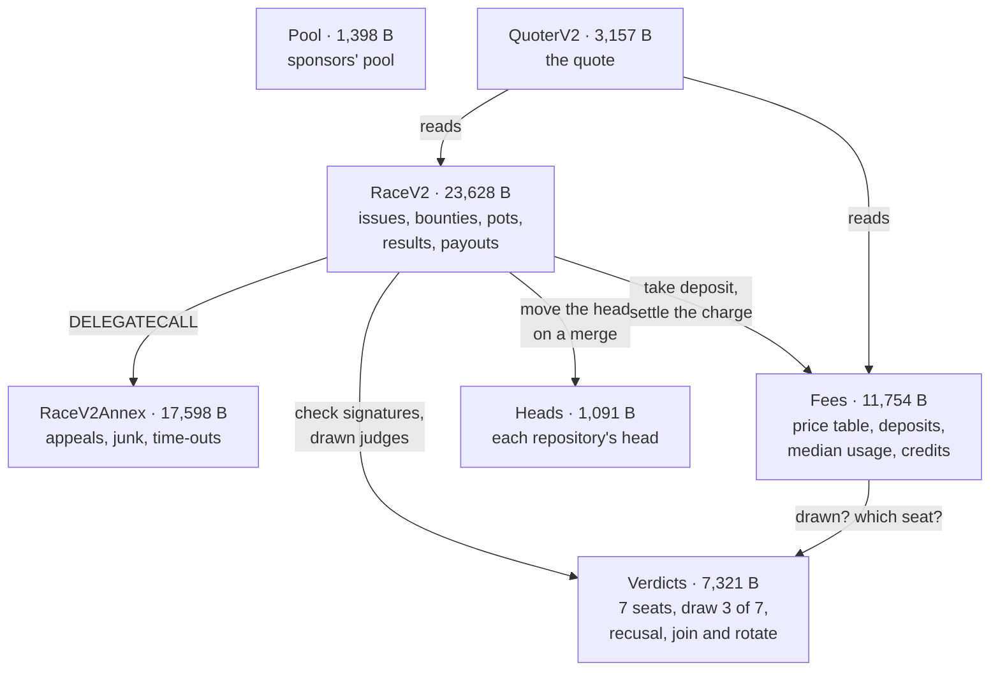
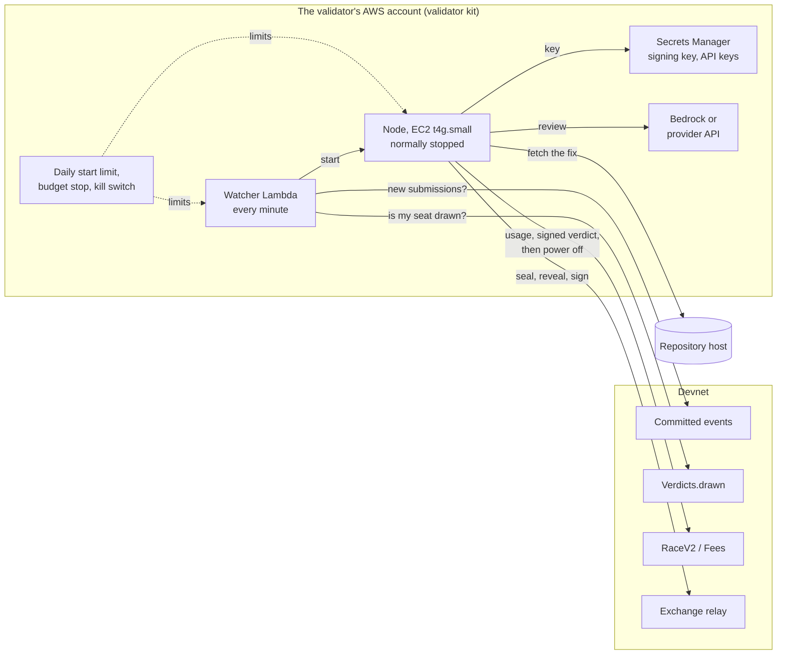
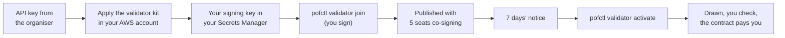
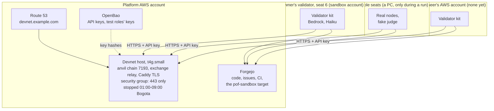

# proof-of-fix

> Private snapshot for sharing. Development happens on a private Forgejo, which keeps the full history; issue numbers (`#123`) refer to its tracker, and example.com and example-org stand in for internal addresses.

**Bounties for open-source fixes, judged by independent AI validators, paid by keyless smart contracts.**

Anyone funds a bounty on an issue. The first fix that passes wins its price. Validators drawn at random check each fix, each running its own AI model on its own infrastructure, and **the contract pays every validator for the checks it counts.** Nobody, the owner included, can change the rules except by a new version.

## Where it stands

| | State |
|---|---|
| **v2** | **Running** on a private Ethereum devnet with a test coin: 7 seats, 3 drawn per fix, 2 must agree. No contract has an owner, an admin, an upgrade or a pause. [ADR 0002](docs/adr/0002-architecture-v2.md) |
| **v3, open validators** | **Designed and simulated, not built:** anyone can register a validator. There are no v3 contracts or node changes yet. [ADR 0004](docs/adr/0004-open-validators.md) |
| **Real money** | **None.** Test coin only, and no token in v2. No real funds until the owner decides to go public (rule 1 in `openspec/config.yaml`). |
| **Access** | Private, for invited engineers. |

### What has run for real

On 2026-11-04 full bounties ran on the AWS devnet, against a private repository on Forgejo ([#150](https://git.example.com/example-org/proof-of-fix/issues/150)). The owner's validator ran in its own AWS account with Claude Haiku through Bedrock, and six test-role seats ran on one PC with a fake judge.

| Shown | Not shown |
|---|---|
| The watcher wakes a stopped node when it's drawn, in time for the round | Judge quality: one failing fix and one small correct fix are easy cases (#160) |
| A node fetches the fix from a private repository, tests it in a sandbox, and calls a real model directly | That a real model can change an outcome: the fake judges hold the majority of any draw |
| The real model's token counts reach the chain, and the seat is credited for them | Independence: six seats ran on one PC |
| Seal, reveal, sign and relay across machines, behind the API keys | Attestation (#94), or anything with real money |
| A failing fix is charged and the bounty stays open; a passing fix wins, merges, moves the head on-chain and settles, and the test roles withdraw their fees | That every balance adds up: nothing totals them yet, and seat 6's fees aren't withdrawn (#152) |

## Where it's going

### v3: open validators

v2's fixed seats become an open registry (#132):
- **Open registration:** a bond of at least $100 and an attestation, then about two weeks judging as a shadow to qualify.
- **Panels that grow:** an odd number of judges, from 1 to 7, following the network's size and the bounty. A single judge's verdict is held and audited.
- **Prices with no vote:** validators post list prices and the median moves them, and a queue signal moves the service fee.
- **Proof levels:** hardware attestation at launch. zkTLS (level C) stays off for now.
- **Reputation:** each model family's score changes its pay and eligibility, never its vote.

**In simulation only,** v3 meets 13 of 13 acceptance criteria under round 3's criteria ([report v3.1](reports/open-validators-v3.1.md)). That's 9 of 13 under round 2's: no rule or number changed, and four verdicts changed by the owner's decisions on how to judge them. Each attacker in those criteria is "not shown to gain", but some attacks still pay and are named as trust points in ADR 0004, such as bribing a judge's silence above the $5 slash. An honest validator nets **−$1.43 ± 0.22 a month at 30 submissions a week, and +$4.77 ± 0.31 at 100**.

### What the design still has to settle

These block v3's contracts (#138):
- **Honest validators' pay at low traffic** (#141): through a token slice (#142) or fee tuning. Model calls are passed through, so the gap is overheads against the fee.
- **Pricing by model family and tier,** with a short approved model list in the constitution, and prices still set by the market (#141).
- **The token in v3's design** (owner, 2026-11-04): v2 stays coin only. Its planned uses, a finder's share and a validators' slice, are still to be simulated, and a real token stays off until the legal review (#126). ADR 0004 still says "no token" and needs updating.
- **Failure has to cost a model:** more weight for an upheld security challenge, plus simulated model-gaming attackers (#141).
- **The verdict as the merge** (#171): on a repository with no maintainers, the judges' verdict moves the head on-chain and mirrors follow. Today the node waits for a host to merge. This also covers separating "merged" from "released", and different acceptance for fixes and features.

### The order of work

1. **Test what's built:** the integration suite (#152) and the leaderboard (#151).
2. **Settle the design:** the simulations above, then the spec.
3. **Build what v3 stands on:** seals and receipts on-chain (5.5, 5.6, #122), bonds and challenges (5.8, #85), attestation (#94).
4. **Build v3:** contracts (#138), node and kit (#139), then the same bounties on the devnet (#140).
5. **Measure the judges:** a paid evaluation with seeded backdoors and an attacker who rehearses against the same models (#160). It's last, and needs the owner's budget approval.
6. **Publish:** a research paper and open code, for others to deploy (#158). There's no launch date, and nobody here plans to run a production network. The aim isn't a system that never fails, but one that heals quickly through market forces, and the evaluation measures that.

## How v2 works

### Who does what


### The contracts (keyless, coin only)

Sizes are runtime bytes; the limit is 24,576 (EIP-170). v1 (`Race`, `Token`, `Quoter`) stays deployed and untouched. Details: [`reports/contract-v2.md`](reports/contract-v2.md).

### The life of a bounty

Today someone with write access performs the merge, and the judges confirm it. Validators only hold read access.

### A validator's infrastructure, in its own AWS account

Idle it costs about $2–3 a month; a run costs about $0.005 plus the model calls. A validator takes work from the contract with no approval per job, so these limits are what protect its bill. See [`validator-kit/`](validator-kit/README.md).

### Joining as an engineer

All 7 seats are in use today, so the organiser hands one over by rotating it to your key. The guide: [`docs/participate.md`](docs/participate.md).

### Where it runs

The devnet is about $15 a month (platform#199, #200). Its stack is planned and applied through Forgejo's pipeline (platform-211).

## What's built and what's left in v2

**Built:** the contracts; the node fetching each fix itself (#115); its sandbox (#116); the relay between judges on separate machines (#117); direct model calls (#118); the judge seeing the issue and the diff (#166); the validator kit and its spending limits (#168, #169); `pofctl`; and the deployment on the AWS devnet (#104, #112, #150).

**Left:**

| Gap | What it means | Why it matters | Issue |
|---|---|---|---|
| **Attestation** (secure hardware) | The node runs in a TEE that proves which checker ran and what the model answered. | Until then, a verdict is trusted on its seat's key alone, which is enough for the devnet but not beyond. | #94 |
| **Bonds, slashing, challenges** (5.8) | Seats post a bond, lost for provable cheating, and anyone can challenge a verdict or a price change. | Without them cheating costs nothing but reputation, and the price challenge isn't enforced. | #85 |
| **Seals on-chain** (5.5) | Judges commit a hash of their verdict before revealing it, enforced by the contract. | Today the nodes enforce it among themselves; on-chain, a lazy judge can't copy another's verdict. | #122 |
| **Receipts on-chain** (5.6) | Each verdict carries its attested receipt's hash, and receipts can be challenged. | It ties every payment to evidence of the check that earned it. | #122 |
| **The verdict as the merge, and the mirror bot** (6.1) | A repository with no maintainers moves its head on the verdict, and bots keep mirrors on it. | Today someone with write access has to merge, so "nobody can merge" (ADR 0001) isn't true yet. | #171 |
| **Data availability** (5.9) | A new head counts only once 5 of 7 seats confirm they hold the code, plus a permanent copy. | Without it, a merged fix could be lost if every host dropped it. | #85, #92 |
| **Constitution and ADR challenges** (5.10) | The constitution's hash on-chain, ADRs passed by 5 of 7 with 14 days of challenges. | It's how the rules change without anyone holding a key. | #85 |
| **The pool and system issues** (5.11) | Regressions on the head become issues, paid from the sponsors' pool. | It's the self-healing loop. | #85 |
| **Migration from v1** (5.13) | v1's bounties finish in v1, and new ones open in v2. | Needed before v2 replaces v1 anywhere it's live. | #85 |
| **Integration suite and leaderboard** | Repeatable tests of every role's interactions, with exact balances, and a public ranking of contributors. | The real runs were one-offs. | #152, #151 |

## Take part

Invited engineers: read [`docs/participate.md`](docs/participate.md). You need an API key from the organiser and an AWS account of your own.

## Running it

```sh
bash scripts/check.sh                                             # OpenSpec validation + all tests (the required check)
scripts/contracts.sh setup && scripts/contracts.sh test           # the contracts, in the pinned Foundry image
python3 -m pof.sim market validators --round3 --seeds 40 --jobs 4 # v3's simulation (report v3.1, a few minutes)
python3 -m pof.sim.openval pricing --seeds 10                     # one part of it: growth, attackers, sybil, audits, levels, pricing or scores
scripts/demo-e2e.sh                                               # v2 end to end on a throwaway devnet
scripts/first-run-e2e.sh                                          # the real run's steps on a throwaway copy (about 15 minutes)
```
Python 3.9 or later, standard library only. A real bounty on the AWS devnet: the runbook's ["The first real run"](validator-kit/runbook.md).

## Research

- **The simulation's history:** [`docs/simulation.md`](docs/simulation.md), with the earlier mechanisms, the upstream target and how to reproduce each run.
- **v3:** [report v3](reports/open-validators-v3.md), [v3.1](reports/open-validators-v3.1.md) and [ADR 0004](docs/adr/0004-open-validators.md).
- **Experiments:** whether verdicts can be re-run deterministically ([`reports/determinism-v1.md`](reports/determinism-v1.md)), and zkTLS ([`reports/zktls-spike-v1.md`](reports/zktls-spike-v1.md)).
- **The paper's outline:** [`docs/paper/outline.md`](docs/paper/outline.md).

## Layout

- `contracts/`: Foundry. v2 is in `contracts/src/v2/`, and v1 stays beside it. Built and tested only in the pinned Foundry image, and deployed only to a throwaway anvil or the private devnet. Libraries are vendored in `contracts/lib/`.
- `oracle/`: the validator's node ([README](oracle/README.md)).
- `exchange/`: the relay between drawn judges, optional by design ([README](exchange/README.md), [`docs/exchange.md`](docs/exchange.md)).
- `validator-kit/`: run a validator in your own AWS account ([README](validator-kit/README.md), [runbook](validator-kit/runbook.md), [costs](validator-kit/COSTS.md)).
- `pofctl/` and `scripts/pofctl`: play every role against a devnet ([README](pofctl/README.md)).
- `bot/`: links issues and pull requests to bounties; the repository hosts are `bot/forge.py` (Forgejo or GitHub, per repository) and `bot/github.py`.
- `scripts/`: `devnet.sh`, `devnet-seats.sh` and `first-bounty.sh` for the devnet, the end-to-end rigs, and `check.sh`.
- `pof/`: the mechanism and `pof/sim/`, including `pof/sim/openval/` for v3.
- `reports/`: simulation, contract and experiment reports. `experiments/`: the experiments' code and results.
- `openspec/`: specs and changes (spec-driven; rules in `openspec/config.yaml`). `openspec/changes/proof-of-fix-132-open-validators/` is v3.
- `docs/adr/`: architecture decision records, and `CONSTITUTION.md`: the rules.
- `docs/onchain-groundwork.md`: an earlier desk study on chains, storage and legal questions.

## Working here

Same pipeline as our other repositories: a Forgejo ticket first, a branch and commits keyed to it, an OpenSpec change for anything that changes the mechanism, and a pull request that passes `pof / check`.
