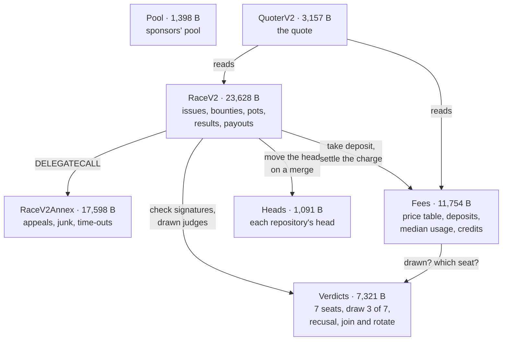
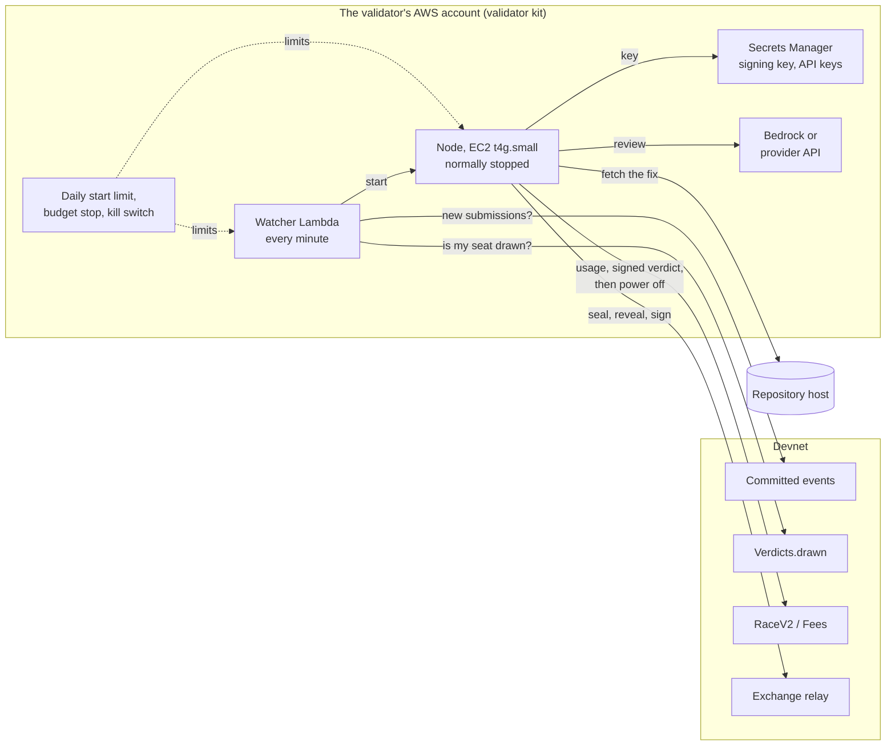
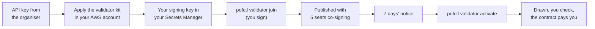
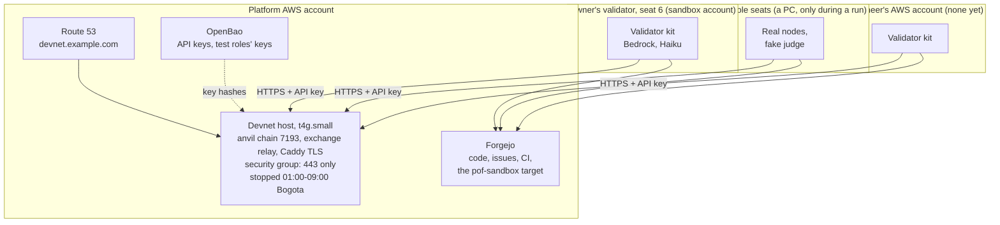
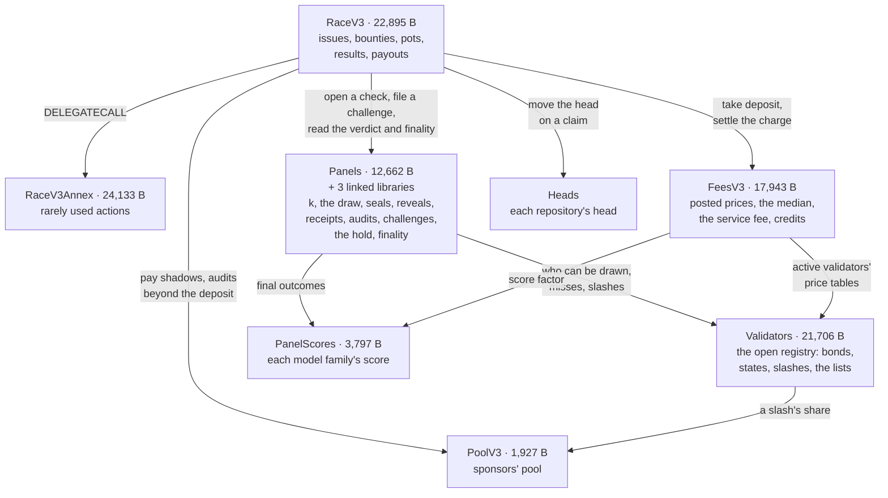
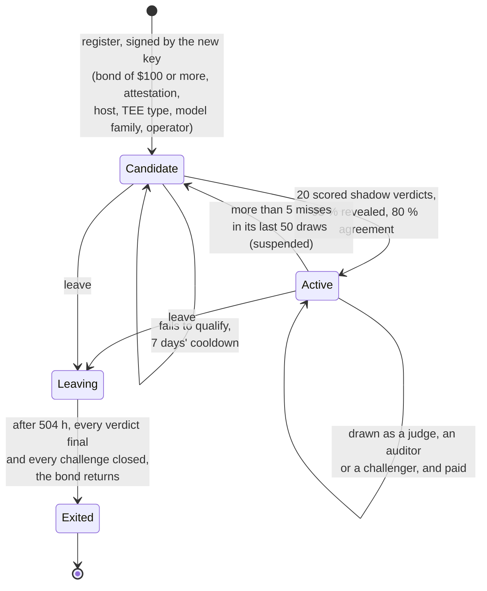
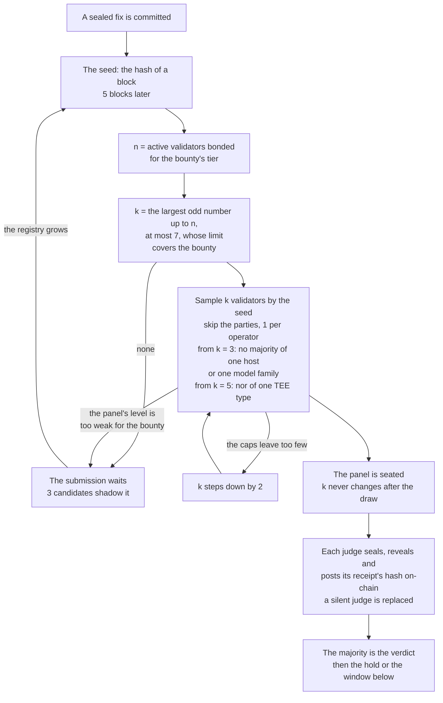
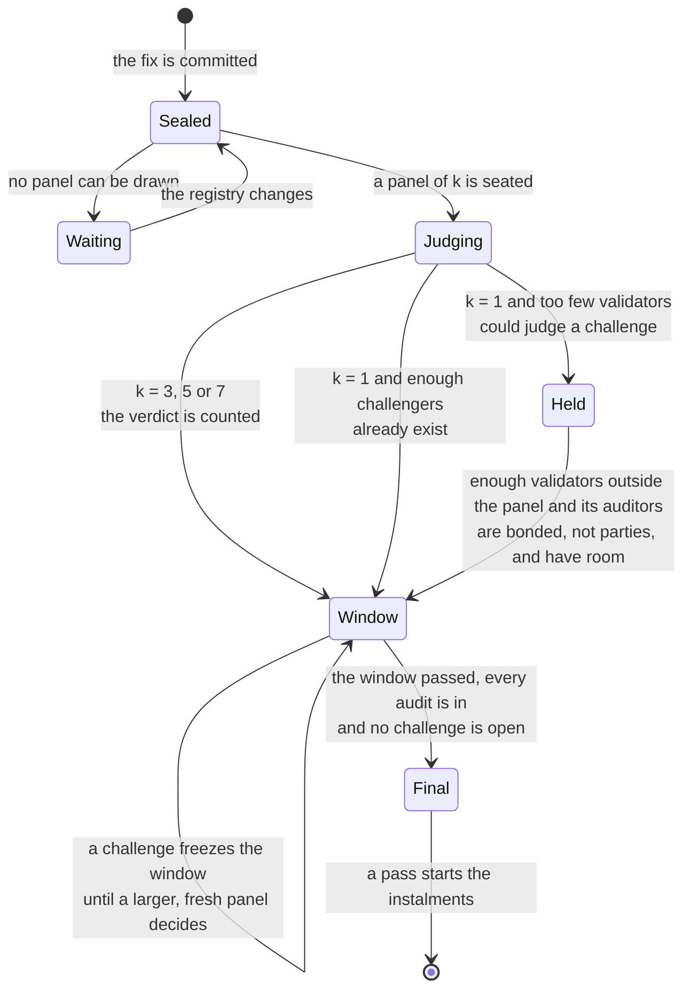

# proof-of-fix

> A scrubbed snapshot. Development happens on a private Forgejo, which keeps the full history; issue numbers (`#123`) refer to its tracker, and example.com and example-org stand in for internal addresses.

**Bounties for open-source fixes, judged by independent AI validators, paid by keyless smart contracts.**

Anyone funds a bounty on an issue. The first fix that passes wins its price. Validators drawn at random check each fix, each running its own AI model on its own infrastructure, and **the contract pays every validator for the checks it counts.** Nobody, the owner included, can change the rules except by a new version.

## Intended use

proof-of-fix is **research**: a mechanism, its simulations and a reference implementation, published to get feedback and collaborators. The design's known flaws are written up openly, starting with [`docs/paper/open-problems.md`](docs/paper/open-problems.md).

- **The only deployment its authors run** is a test deployment on **Ethereum Sepolia**, a public test chain whose coins have no value. Its contracts serve **one repository, proof-of-fix itself**, and refuse to deploy on any other chain (design: [`openspec/changes/proof-of-fix-251-testnet-launch/`](openspec/changes/proof-of-fix-251-testnet-launch/)).
- **Those limits bind that deployment, not the code.** The code is open; anyone may fork it and deploy it elsewhere. Such deployments are their operators' own, with their own responsibilities, and nothing here endorses them.
- **No token sale, no promise of earnings.** Test bounties and fees are paid in the project's own **test coin**, "proof-of-fix test coin" (`POFTEST`), which has no value: nobody sells it and there is no market for it. Nothing in this repository is financial advice or an offer of anything of value.
- **Where the test coin comes from.** A fixed genesis mint at deployment (the launch validators' bonds and a few seed bounties), then only a keyless faucet contract: 20 coins a claim, one claim per address every 2 hours, anyone for itself (`pofctl faucet`). Addresses are free, so a bot can claim from many; spam on the testnet is bounded by the validators' capacity and spending caps, not by the coin, a known risk ([ADR 0007](docs/adr/0007-solver-side-parameters.md), trust point 6).
- **Not audited.** The contracts haven't had an external security audit. Don't put real money in them.
- **Amounts in dollars** (bonds, fees, bounty tiers, the simulations' results) are the design's units: on the testnet each dollar is one test coin, which is worth nothing.

## Where it stands

| | State |
|---|---|
| **v2** | **Running** on a private Ethereum devnet with a test coin: 7 seats, 3 drawn per fix, 2 must agree. No contract has an owner, an admin, an upgrade or a pause. [ADR 0002](docs/adr/0002-architecture-v2.md) |
| **v3, open validators** | **Contracts built and tested, not deployed:** anyone can register a validator. The node, the validator kit and the devnet run are next (#139, #140). [ADR 0004](docs/adr/0004-open-validators.md), [`reports/contract-v3.md`](reports/contract-v3.md) |
| **Real money** | **None.** Test coin only, and no token. The Sepolia deployment uses the test coin, POFTEST, which has no value ([intended use](#intended-use)). |
| **Access** | The code is public. The v2 devnet is private, for invited engineers. |

### What has run for real

On 2026-11-04 full bounties ran on the AWS devnet, against a private repository on Forgejo ([#150](https://git.example.com/example-org/proof-of-fix/issues/150)). The owner's validator ran in its own AWS account with Claude Haiku through Bedrock, and six test-role seats ran on one PC with a fake judge.

| Shown | Not shown |
|---|---|
| The watcher wakes a stopped node when it's drawn, in time for the round | Judge quality: one failing fix and one small correct fix are easy cases (#160) |
| A node fetches the fix from a private repository, tests it in a sandbox, and calls a real model directly | That a real model can change an outcome: the fake judges hold the majority of any draw |
| The real model's token counts reach the chain, and the seat is credited for them | Independence: six seats ran on one PC |
| Seal, reveal, sign and relay across machines, behind the API keys | Attestation (#94), or anything with real money |
| A failing fix is charged and the bounty stays open; a passing fix wins, merges, moves the head on-chain and settles, and the test roles withdraw their fees | That every balance adds up: nothing totals them yet, and seat 6's fees aren't withdrawn (#152) |

## Where it's going

### v3: open validators

v2's fixed seats become an open registry (#132). The contracts are built ([`reports/contract-v3.md`](reports/contract-v3.md)); the diagrams are in [How v3 works](#how-v3-works).
- **Open registration:** a bond of at least $100 and an attestation, then about two weeks judging as a shadow to qualify.
- **Panels that grow:** an odd number of judges, from 1 to 7, following the network's size and the bounty (the k table). A single judge's verdict is held and audited twice.
- **Prices with no vote:** validators post list prices and the median moves them, and a queue signal moves the service fee.
- **Proof levels:** hardware attestation at launch. zkTLS (level C) stays off for now.
- **Reputation:** no list of model families. Each family's score ranks it: the score changes its pay and eligibility, never its vote, and a cap keeps one family from holding a panel's majority. The rank and the per-family cap are under review in #236, after the judge measurements ([`reports/judges-v2.md`](reports/judges-v2.md)).

**In simulation only,** v3 meets 13 of 13 acceptance criteria under round 3's criteria ([report v3.1](reports/open-validators-v3.1.md)). That's 9 of 13 under round 2's: no rule or number changed, and four verdicts changed by the owner's decisions on how to judge them. Each attacker in those criteria is "not shown to gain", but some attacks still pay and are named as trust points in ADR 0004, such as bribing a judge's silence above the $5 slash. An honest validator nets **−$1.43 ± 0.22 a month at 30 submissions a week, and +$4.77 ± 0.31 at 100**.

### What the design still has to settle

These were listed as blocking v3's contracts (#138). The contracts were built on 2026-11-13 with ADR 0004's values, and these stay open unless marked:
- **Honest validators' pay at low traffic** (#141): through a token slice (#142) or fee tuning. Model calls are passed through, so the gap is overheads against the fee.
- **Pricing by model family: decided** (owner, 2026-11-13; design D19). There is no approved list: any family may register, and other families' validators set its first price.
- **The token in v3's design** (owner, 2026-11-04): v2 stays coin only. Its planned uses, a finder's share and a validators' slice, are still to be simulated, and a real token stays off until the legal review (#126). ADR 0004 still says "no token" and needs updating.
- **Failure has to cost a model:** more weight for an upheld security challenge, plus simulated model-gaming attackers (#141).
- **The verdict as the merge** (#171): on a repository with no maintainers, the judges' verdict moves the head on-chain and mirrors follow. Today the node waits for a host to merge. This also covers separating "merged" from "released", and different acceptance for fixes and features.

### The order of work

1. **Test what's built:** the integration suite (#152) and the leaderboard (#151).
2. **Settle the design:** the simulations above, then the spec.
3. **Build what v3 stands on: done inside v3.** v3 has its own seals, reveals and receipts on-chain, and its own bonds, slashes and challenges (design D18). Attestation is a recorded hash, with a simulated proof type on devnets only; real attestation is still #94.
4. **Build v3:** contracts (#138, built), then the node and kit (#139), then the same bounties on the devnet (#140).
5. **Measure the judges:** the paid, pre-registered run (#160) is reported in [`reports/judges-v2.md`](reports/judges-v2.md). What it means for the panels is #236.
6. **Publish:** a research paper and open code, for others to deploy (#158). There's no launch date, and nobody here plans to run a production network. The aim isn't a system that never fails, but one that heals quickly through market forces, and the evaluation measures that.

## How v2 works

### Who does what


### The contracts (keyless, coin only)

Sizes are runtime bytes; the limit is 24,576 (EIP-170). v1 (`Race`, `Token`, `Quoter`) stays deployed and untouched. Details: [`reports/contract-v2.md`](reports/contract-v2.md).

### The life of a bounty

Today someone with write access performs the merge, and the judges confirm it. Validators only hold read access.

### A validator's infrastructure, in its own AWS account

Idle it costs about $2–3 a month; a run costs about $0.005 plus the model calls. A validator takes work from the contract with no approval per job, so these limits are what protect its bill. See [`validator-kit/`](validator-kit/README.md).

### Joining as an engineer

All 7 seats are in use today, so the organiser hands one over by rotating it to your key. The guide: [`docs/participate.md`](docs/participate.md). In v3 there is no seat to hand over: see [the open registry](#the-open-registry-a-validators-states).

### Where it runs

The devnet is about $15 a month (infra#199, #200). Its stack is planned and applied through Forgejo's pipeline (platform-211).

## How v3 works

**Built and tested, not deployed.** The contracts are in `contracts/src/v3/`; the numbers are [ADR 0004](docs/adr/0004-open-validators.md)'s. The node and the kit still speak v2 (#139), and no devnet runs v3 yet (#140). v2 stays deployed and unchanged.

### The contracts (keyless, coin only)

Sizes are runtime bytes; the limit is 24,576 (EIP-170). `Panels` runs its rules in three linked libraries (`PanelsVerdict` 20,156 B, `PanelsJudge` 12,061 B, `PanelsDraw` 9,095 B). No contract has an owner, an admin or a setter. Details: [`reports/contract-v3.md`](reports/contract-v3.md).

### The open registry: a validator's states

- **No seat and no co-signers:** nobody approves a registration. The deployment names at most one genesis validator, at level A or B.
- **The bond decides which bounties a validator can judge:** at least 2 × the bounty's tier ($10, $25, $50, $125, $250, $312.50, $625).
- **A validator is slashed only for a provable fault.** A false verdict upheld by a challenge, or a reveal that doesn't match its seal, costs the whole bond. Silence, or a sealed vote not revealed, costs a counted judge $5. A mere disagreement costs nothing. A leaving validator can still be slashed.
- **Not drawn, bond kept:** a validator whose TEE type, proof type or image left the constitution's list, or whose firmware is below the minimum, until it re-attests.
- **A model family is fixed by the registration.** Changing it means registering again.

### The k table: how large a panel is
k is the number of counted judges: odd, from 1 to 7. It follows how many validators are eligible for the bounty, and the bounty must fit the limit of that k.

| k | Eligible validators needed | Largest bounty, level A | Level B | Challenge window, level A | Level B | A challenge is judged by |
|---|---|---|---|---|---|---|
| 1 | 1 | $50 | $25 | 168 h, after the hold | 336 h | 3 |
| 3 | 3 | $250 | $125 | 24 h | 48 h | 5 |
| 5 | 5 | $625 | $312.50 | 12 h | 24 h | 7 |
| 7 | 7 | $625 | $312.50 | 6 h | 12 h | 7 |

Level A is a TEE in a cloud and level B a TEE elsewhere. A panel's level is the weakest level among its majority. Level C (zkTLS) has its own row in ADR 0004 and is off at launch.


- **The draw can be recomputed by anyone.** It reads a snapshot taken when the seed block was set, so a change to the registry after that can only remove a validator from a draw.
- **Shadows:** each draw also seats 1 candidate as a shadow (2 while fewer than 7 validators are active). That's how newcomers qualify.
- **Audits:** 10 % of submissions are re-run by one auditor outside the panel. Whether a verdict is audited is decided by a later block, so the judges can't know when they vote.
- **The constitution tier** is always 7 judges, 5 to pass. It needs 21 eligible validators for an ADR that adds or loosens, and 14 for one that only removes.
- **The TEE-type cap** starts at k = 5 while fewer than 5 TEE types are accepted (3 at launch), and at k = 3 with 5 or more.

### The k = 1 hold: a lone verdict waits for its challengers

- **How many validators a held verdict needs.** Six eligible validators outside its panel before its audits are drawn (seven in all, with the judge), then three outside the judge and its auditors after (six in all, with two auditors). Each must be bonded for the bounty, not a party, and have room under its k = 1 limit now. That is the challenge panel of 3, plus one for each audit still to be drawn, since an auditor sits out of the challenge. Below that every lone verdict stays held; at exactly the threshold, one validator pausing or filling up holds them all.
- **Nothing of the bounty is paid while a verdict is held or its window runs.** The judges' fees are paid when the verdict is posted; only the bounty waits.
- **Every k = 1 verdict is audited by two auditors outside its panel,** each drawn as soon as one is eligible. An audit that disagrees opens a challenge.
- **A validator has at most 10 k = 1 verdicts not yet final.** At 10 it isn't drawn at k = 1.
- **A pass reversed before finality takes the award back** and reopens the bounty.
- **The cost, in simulation:** an honest k = 1 fix is paid a median 19.4 days after its verdict, on 2 % of panels (ADR 0004).

## What's built and what's left in v2

**Built:** the contracts; the node fetching each fix itself (#115); its sandbox (#116); the relay between judges on separate machines (#117); direct model calls (#118); the judge seeing the issue and the diff (#166); the validator kit and its spending limits (#168, #169); `pofctl`; and the deployment on the AWS devnet (#104, #112, #150).

**Left:**

| Gap | What it means | Why it matters | Issue |
|---|---|---|---|
| **Attestation** (secure hardware) | The node runs in a TEE that proves which checker ran and what the model answered. | Until then, a verdict is trusted on its seat's key alone, which is enough for the devnet but not beyond. | #94 |
| **Bonds, slashing, challenges** (5.8) | Seats post a bond, lost for provable cheating, and anyone can challenge a verdict or a price change. | Without them cheating costs nothing but reputation, and the price challenge isn't enforced. | #85 |
| **Seals on-chain** (5.5) | Judges commit a hash of their verdict before revealing it, enforced by the contract. | Today the nodes enforce it among themselves; on-chain, a lazy judge can't copy another's verdict. | #122 |
| **Receipts on-chain** (5.6) | Each verdict carries its attested receipt's hash, and receipts can be challenged. | It ties every payment to evidence of the check that earned it. | #122 |
| **The verdict as the merge, and the mirror bot** (6.1) | A repository with no maintainers moves its head on the verdict, and bots keep mirrors on it. | Today someone with write access has to merge, so "nobody can merge" (ADR 0001) isn't true yet. | #171 |
| **Data availability** (5.9) | A new head counts only once 5 of 7 seats confirm they hold the code, plus a permanent copy. | Without it, a merged fix could be lost if every host dropped it. | #85, #92 |
| **Constitution and ADR challenges** (5.10) | The constitution's hash on-chain, ADRs passed by 5 of 7 with 14 days of challenges. | It's how the rules change without anyone holding a key. | #85 |
| **The pool and system issues** (5.11) | Regressions on the head become issues, paid from the sponsors' pool. | It's the self-healing loop. | #85 |
| **Migration from v1** (5.13) | v1's bounties finish in v1, and new ones open in v2. | Needed before v2 replaces v1 anywhere it's live. | #85 |
| **Integration suite and leaderboard** | Repeatable tests of every role's interactions, with exact balances, and a public ranking of contributors. | The real runs were one-offs. | #152, #151 |

## Take part

v3.1 is live on the Sepolia testnet (test coin only; it supersedes v3): **[start here](docs/take-part.md)**, then [fund an issue](docs/guides/fund-an-issue.md), [submit a fix as a Radicle patch](docs/guides/submit-a-fix.md) or [run a validator](docs/guides/run-a-validator.md).

[`docs/participate.md`](docs/participate.md) describes the earlier private v2 devnet, which v3 replaces.

## Running it

```sh
bash scripts/check.sh                                             # OpenSpec validation + all tests (the required check)
scripts/contracts.sh setup && scripts/contracts.sh test           # the contracts, in the pinned Foundry image
python3 -m pof.sim market validators --round3 --seeds 40 --jobs 4 # v3's simulation (report v3.1, a few minutes)
python3 -m pof.sim.openval pricing --seeds 10                     # one part of it: growth, attackers, sybil, audits, levels, pricing or scores
scripts/demo-e2e.sh                                               # v2 end to end on a throwaway devnet
scripts/first-run-e2e.sh                                          # the real run's steps on a throwaway copy (about 15 minutes)
```
Python 3.9 or later, standard library only. A real bounty on the AWS devnet: the runbook's ["The first real run"](validator-kit/runbook.md).

## Research

- **The simulation's history:** [`docs/simulation.md`](docs/simulation.md), with the earlier mechanisms, the upstream target and how to reproduce each run.
- **v3:** [report v3](reports/open-validators-v3.md), [v3.1](reports/open-validators-v3.1.md), [ADR 0004](docs/adr/0004-open-validators.md) and the contracts' report, [`reports/contract-v3.md`](reports/contract-v3.md).
- **The judges, measured:** [`reports/judges-v2.md`](reports/judges-v2.md) (#160).
- **Experiments:** whether verdicts can be re-run deterministically ([`reports/determinism-v1.md`](reports/determinism-v1.md)), and zkTLS ([`reports/zktls-spike-v1.md`](reports/zktls-spike-v1.md)).
- **The paper's outline:** [`docs/paper/outline.md`](docs/paper/outline.md).

## Layout

- `contracts/`: Foundry. v2 is in `contracts/src/v2/` and v3 in `contracts/src/v3/`, and v1 stays beside them. Built and tested only in the pinned Foundry image, and deployed only to a throwaway anvil or the private devnet. Libraries are vendored in `contracts/lib/`.
- `oracle/`: the validator's node ([README](oracle/README.md)).
- `exchange/`: the relay between drawn judges, optional by design ([README](exchange/README.md), [`docs/exchange.md`](docs/exchange.md)).
- `validator-kit/`: run a validator in your own AWS account ([README](validator-kit/README.md), [runbook](validator-kit/runbook.md), [costs](validator-kit/COSTS.md)).
- `pofctl/` and `scripts/pofctl`: play every role against a devnet ([README](pofctl/README.md)).
- `bot/`: links issues and pull requests to bounties; the repository hosts are `bot/forge.py` (Forgejo or GitHub, per repository) and `bot/github.py`.
- `scripts/`: `devnet.sh`, `devnet-seats.sh` and `first-bounty.sh` for the devnet, the end-to-end rigs, `integration.sh`, the integration suite's seven scenarios on a throwaway local devnet (#152; `tests/integration/`), `check.sh`, `github_snapshot.py`, which refreshes the scrubbed GitHub copies and makes the public Radicle snapshot (`--target radicle`), and `github_issues.py`, which mirrors the tracker's issues there, scrubbed and with the same numbers (#178).
- `pof/`: the mechanism and `pof/sim/`, including `pof/sim/openval/` for v3.
- `reports/`: simulation, contract and experiment reports. `experiments/`: the experiments' code and results.
- `openspec/`: specs and changes (spec-driven; rules in `openspec/config.yaml`). `openspec/changes/proof-of-fix-132-open-validators/` is v3.
- `docs/adr/`: architecture decision records, and `CONSTITUTION.md`: the rules.
- `docs/onchain-groundwork.md`: an earlier desk study on chains, storage and legal questions.

## Working here

Same pipeline as our other repositories: a Forgejo ticket first, a branch and commits keyed to it, an OpenSpec change for anything that changes the mechanism, and a pull request that passes `pof / check`.

## Licence

Licensed under either of

- the Apache License, Version 2.0 ([`LICENSE-APACHE`](LICENSE-APACHE)), or
- the MIT licence ([`LICENSE-MIT`](LICENSE-MIT)),

at your option. Unless you explicitly state otherwise, any contribution you intentionally submit for inclusion in this work, as defined in the Apache-2.0 licence, shall be dual-licensed as above, without any additional terms or conditions.

Third-party code under `contracts/lib/` keeps its own licences ([`contracts/lib/README.md`](contracts/lib/README.md)).
