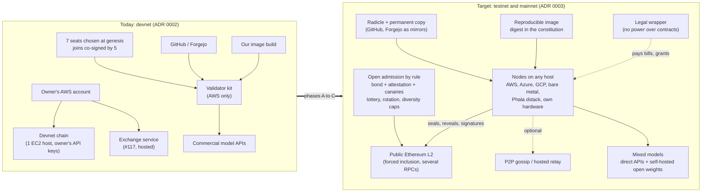
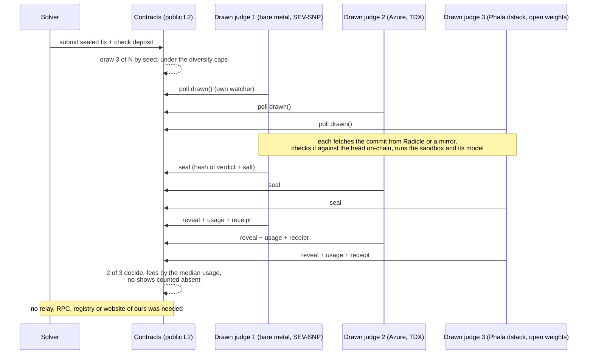

# ADR 0003: Decentralize the chain, the validators and their infrastructure: nothing one party runs is required

- **Status:** proposed by the owner (#121, 2026-11-02). It sets the **target** architecture. The devnet keeps running as ADR 0002 describes, for testing.
- **Date:** 2026-11-02
- **Author:** the owner (proof-of-fix#121). Interest disclosed: the owner may run one validator seat, which follows the same rules as any other seat (#82, #112).
- **Constitution articles changed:** none yet. The diversity caps and the accepted attestation types become constitution text through their own ADRs, once the issues below are built.
- **Protected paths touched:** `docs/adr/0003-decentralization.md`

## Problem
The contracts are keyless: no owner, admin, upgrade or pause (ADR 0002, D15). **Everything around them is not.** If the owner stops, or a single company acts, the system stops:

| Central point today (ADR 0002) | What one party can do |
|---|---|
| **The chain:** one EC2 instance in the owner's AWS account; the API keys issued by the owner | stop the chain, read every call, refuse a user |
| **The validators:** 7 seats chosen at genesis by the owner; new seats co-signed by 5 sitting seats | keep the set closed; collude as a committee |
| **The validator infrastructure:** the kit (#106) supports **AWS only** | one provider's outage, policy change or account ban removes the whole quorum |
| **The exchange of seals, reveals and signatures** between drawn judges: a service we would host (#117) | if it's down, checks stall; it sees all traffic first |
| **The code:** target repositories on GitHub; proof-of-fix on our Forgejo | a host removes a repository or an account |
| **The node image:** built and published by us | users must trust our build machine and our registry |
| **The models:** a few commercial APIs, via a gateway in development | a provider stalls, censors, changes its model or raises prices |
| **The legal and financial shell:** the owner personally | personal liability; the owner is the public contact |

The owner (2026-11-02): *"we don't have the right decentralization, first for the validators and also for the infra itself… make the architecture and production more resilient and more decentralized."*

## Options
1. **Keep the current architecture** and add decentralization after going public. Nothing to change now. But central services get built into the nodes, the kit and the docs (#117 would be the first), and removing them later means breaking changes, after users depend on them.
2. **Move everything to public infrastructure now:** a public testnet, public repositories and public images. This would be the fastest to decentralize, but it breaks the under-wraps rule and rule 1 (no outward footprint or real money before the owner's review), and it would stop the devnet demo.
3. **Set the target now and build toward it in phases, keeping the devnet for testing:**
   - every component is designed so that **anything one party runs is optional**, with a path that needs only the chain and the participant's own machine;
   - the public steps (a public chain, public repositories, public images) wait for going public (D1).

## Decision
Option 3. Five principles, then the target for each layer, then the phases.

### Principles
1. **Nothing one party runs is required.** Anything we host (a relay, an RPC endpoint, a registry, a website) is a **convenience** with a tested fallback that needs only the chain and the participant's own machine.
2. **Neutral to cloud and hardware.** The contract checks an **attestation of an accepted type** and **signatures**, nothing else. Where a node runs is the operator's choice.
3. **Diversity is enforced by rule, not hoped for:**
   - caps per operator, per cloud or hardware host, per TEE type and per model family;
   - a draw can't be dominated by one of them.
4. **Anyone can rebuild and check everything:**
   - reproducible images;
   - the kits and the docs are open to every participant;
   - verdicts carry receipts that anyone can check.
5. **The legal shell is separate from the protocol.** A legal entity may pay bills and receive grants. It never holds a key, seat or vote over the contracts.

### Target, layer by layer
| Layer | Target | Issue |
|---|---|---|
| **Chain** | **Testnet and mainnet on a public Ethereum layer-2**, chosen for: <ul><li>a working **forced-inclusion** path (users can bypass the sequencer);</li><li>permissionless fraud or validity proofs (L2BEAT stage 1 or better);</li><li>EIP-170 and EIP-3860 rules like mainnet.</li></ul> **Several RPC providers**, plus a light client or own node for anyone. The devnet stays single-host and **is only for testing.** | #82 (after D1) |
| **Validator set** | **Open admission by rule** (#100 comment 4988): <ul><li>a bond, an attestation of the official image, and a qualification period on canaries;</li><li>then automatic admission, with a **lottery** when there are more candidates than seats;</li><li>**rotation**, and **21+ seats** at mainnet.</li></ul> No committee co-signs a join. | #100 |
| **Diversity caps** | At most **1 seat per operator**. At most **2 of 7 seats** (and **under a third** at any size) per cloud or hardware host, per TEE type and per model family. The draw skips a seat that would break a cap in that draw. The numbers are proposed, to check by simulation first. | #100 |
| **Validator infrastructure** | **A cloud-neutral kit:** <ul><li>one container and a generic watcher (systemd timer, cron or Compose);</li><li>**adapters:** AWS (today's kit), Azure and Google Cloud confidential VMs (TDX, SEV-SNP), **bare metal with SEV-SNP or TDX** from any host, **Phala dstack** (cloud or self-hosted), and the operator's own hardware (devnet only, no attestation).</li></ul> | #123 |
| **Exchange between judges** | **On-chain:** <ul><li>seals, reveals and signatures posted to the contract (task 5.5) are the **primary path;**</li><li>optional **peer-to-peer gossip** (libp2p or Waku) for speed;</li><li>a **hosted relay** (#117) as a convenience only.</li></ul> The node's transport is pluggable. | #122, #117 |
| **Code and data** | <ul><li>**Radicle first** for public repositories (#92), with each repository's head recorded on-chain (`Heads`);</li><li>a **permanent copy** of each checked commit: 5 of 7 operators keep it, plus Arweave (data availability, task 5.9);</li><li>GitHub and Forgejo stay as **mirrors**, read by adapters (#108).</li></ul> | #92, #85 (5.9) |
| **Images** | <ul><li>a **reproducible build:** one digest, rebuilt by anyone;</li><li>published to several registries and to IPFS;</li><li>the **accepted digests** listed in the constitution (changed by ADR).</li></ul> | #124 |
| **Models** | A **mix:** <ul><li>commercial providers called **directly** (#118);</li><li>**self-hosted open-weight models** on confidential GPUs or decentralized inference networks (#125), under the per-provider cap;</li><li>receipts per IETF draft-tsyrulnikov-rats-attested-inference-receipt.</li></ul> The AgentCore gateway is for development only. | #118, #125, #94 |
| **Monitoring** | **Anyone can watch:** the canaries, the draw, the receipts and the usage are on-chain. Watchers and challengers need no account with us. | #85 (5.6, 5.8) |
| **Legal and financial shell** | **A DAO LLC or a foundation** for grants, bills and liability, keeping the founder out of public view. It has **no power over the contracts.** This is a desk study for the legal review (D6); nothing is filed before the owner decides. | #126 |

### Today and the target

### How a check flows when nothing we run is up

### Phases
The demo keeps working at every step. Each phase ends with `scripts/demo-e2e.sh` passing.

| Phase | Where | What changes | Issues |
|---|---|---|---|
| **A: now** | the private devnet | <ul><li>a pluggable transport in the node, with the hosted service optional;</li><li>**seals and reveals on-chain;**</li><li>a **cloud-neutral kit** with two non-AWS adapters;</li><li>a **reproducible image;**</li><li>diversity caps simulated;</li><li>the legal-wrapper desk study.</li></ul> | #117, #122, #123, #124, #100, #126 |
| **B: public testnet** (after D1) | a public L2 testnet | <ul><li>**open admission** with bonds (5.8) and attestation (#94);</li><li>diversity caps in the contract;</li><li>Radicle for public repositories;</li><li>images on IPFS;</li><li>several RPC providers;</li><li>a self-hosted model seat.</li></ul> | #82, #100, #92, #124, #125, #94 |
| **C: mainnet** | a public L2 | <ul><li>21+ rotating seats;</li><li>no hosted dependency left;</li><li>the legal wrapper in place, if chosen;</li><li>v1 to v2 migration (5.13).</li></ul> | #85, #126 |

## Evidence
- **The keyless contracts already allow this:** a seat is a key plus metadata, and the contract checks only signatures (and, once built, attestations). Nothing in `Verdicts`, `Fees` or `RaceV2` assumes AWS (ADR 0002 §1).
- **The node already runs without our services:** five independent nodes with quorum 3, a forged relay refused, and canaries scoring a lying node 0 % ([`reports/oracle-v2.md`](../../reports/oracle-v2.md)). The demo passes with the 3 drawn of 7 nodes (#113).
- **The non-AWS TEEs exist and are documented** in the #85 design (S14):
  - Intel TDX, through Phala dstack (open source, self-hostable) or a confidential VM on Azure or Google Cloud;
  - AMD SEV-SNP;
  - NVIDIA confidential-computing GPUs, for self-hosted models.
- **To measure in phase A:** the gas for seals and reveals per check (#122), the cost of each adapter (#123), the image's reproducibility (#124), and the diversity caps by simulation (#100).

## Consequences
- **Validators** can run on any accepted host, including their own hardware for the devnet. They choose by cost and trust, and the caps keep any one host from dominating.
- **Checks cost a little more gas** (seals and reveals on-chain), paid through the existing gas reimbursement in the fee table (#111), and take a little longer (a seal deadline before reveals).
- **More to test:** each adapter, each attestation type, and the transport backends. The core is shared, so an adapter stays thin.
- **The owner's role shrinks to one seat and to services** (support, hosting a relay, the docs). None of them is required.
- **What stays the same:** the devnet and its demo (ADR 0002), the keyless contracts, the fee table and the under-wraps rule until D1.
- **Changes to ADR 0002's plan:** #117's hosted exchange becomes optional (it's being built that way). #112 (the owner's seats) uses the cloud-neutral kit when it's ready. The diversity caps and accepted attestation types go into the constitution by their own ADRs.

## Challenge window
None yet. This sets a direction before any constitution tier exists. The constitution text it leads to (diversity caps, attestation types, image digests) follows Article 9 when proposed.
