# Taking part in the proof-of-fix devnet

You run the AI check for open-source fixes on **your own AWS account**, and the **contract pays you** for every check it counts. This guide is for engineers invited to the private devnet (proof-of-fix#104).

**Confidentiality:** proof-of-fix is private. You're invited personally: please don't share the endpoint, your key, the code or this guide.

## What you get from the organiser
- **The chain's address:** `https://devnet.example.com`. This is a private Ethereum devnet (chain 7193) with mainnet's rules. It's up from 09:00 to 01:00 Bogota time.
- **Your API key** for it (`<handle>:<key>`, HTTP basic auth). Without it the endpoint answers 401.
- **The deployment record** (`devnet-v2.json`): the contracts' addresses.
- **A vacant seat number** (0–6), and the **node image digest** every validator runs.
- **The demo repository on GitHub** whose pull requests are the fixes you'll check.

## What you deploy (about 20 minutes)
**The validator kit** ([`validator-kit/`](../validator-kit/README.md), runbook: [`validator-kit/runbook.md`](../validator-kit/runbook.md)) is a Terraform module for **your** AWS account:
- **A watcher Lambda** that checks the chain every minute and **starts your node only when your seat is drawn** for a fix.
- **A node instance** (t4g.small) that is **normally stopped.** When started, it fetches the fix, runs its tests in a sandbox with no network, asks your model, signs your usage report and verdict, sends them, then **powers itself off.**
- **Your signing key** in your Secrets Manager. You create it, and it never passes through Terraform.
- **Your model access:** any provider: Bedrock in your account (the AWS adapter), or an API key for Anthropic, OpenAI, Gemini or any OpenAI-compatible server, self-hosted included (ADR 0003). Your node calls it **directly**, never through a gateway, so its receipt can show what the provider answered and counted. There are spending guards per run, a budget alarm and a kill switch.

**Cost to you:** about **$2–3 a month idle** (a disk, a few secrets, the Lambda), plus about **$0.005 of compute per run**, and your model calls.

## How you join

```mermaid
flowchart LR
  A[API key from the organiser] --> B[Apply the validator kit<br/>in your AWS account]
  B --> C[Create your signing key<br/>in your Secrets Manager]
  C --> D["pofctl validator join --seat n<br/>(you sign the join)"]
  D --> E[Organiser publishes it<br/>with 5 seats co-signing]
  E --> F[7 days' notice]
  F --> G["pofctl validator activate<br/>your seat is active"]
  G --> H[Drawn for fixes, you check,<br/>the contract pays you]
```

On the devnet the 7 days can be fast-forwarded. Seat bonds come later (task 5.8); there's none on the devnet.

## How you're drawn and paid
- **For each fix submitted,** the contract draws **3 of the 7 seats** at random, using a seed fixed when the fix was committed. 2 of the 3 must agree. A seat whose operator is a party to the bounty (its reporter, the solver or a funder) is skipped, and the next one sits.
- **For each check the contract counts, you're paid:**
  - your **measured usage** (model tokens, sandbox CPU and memory, storage), at the published price table, and **the median** of the drawn judges', so nobody gains by padding;
  - plus the **$0.05 service fee.**
- **The solver pays** from a deposit sized for the worst case, and gets the rest back. You're paid **in the fee coin, not a token.** Your pay builds up as a credit, and you withdraw it:
  ```
  scripts/pofctl --as engineer validator status     # your seat, draws, verdicts, usage reports, fees earned
  scripts/pofctl --as engineer validator withdraw   # pull your credit
  ```
- **Prices** change only by 5 of 7 seats signing, within ±25 %, never above 2× the starting price, and after 7 days' notice.

## Commands you'll use (`scripts/pofctl`, no install)
```
export POFCTL_RPC=https://devnet.example.com POFCTL_RPC_TOKEN="<handle>:<key>" POFCTL_RPC_AUTH=Basic
scripts/pofctl --record devnet-v2.json status
scripts/pofctl --record devnet-v2.json solver quote --bounty 1   # what a fix pays, the check deposit, the service fee
scripts/pofctl --record devnet-v2.json --as engineer validator join --seat <n>
scripts/pofctl --record devnet-v2.json --as engineer validator status
```
You can also play the other roles (funder, reporter, solver): see [`pofctl/README.md`](../pofctl/README.md).

## What isn't there yet
The devnet demonstrates the money and the draw end to end, but some parts of a real network are still to come. See **"What's built and what's left"** in the [README](../README.md#whats-built-and-whats-left). Most importantly:
- verdicts aren't attested by secure hardware yet, so the devnet trusts each seat's key;
- validators in different accounts still need the small service that exchanges sealed verdicts (#94);
- the node still has to fetch each fix's code itself and run its sandbox from inside its container (#112).
